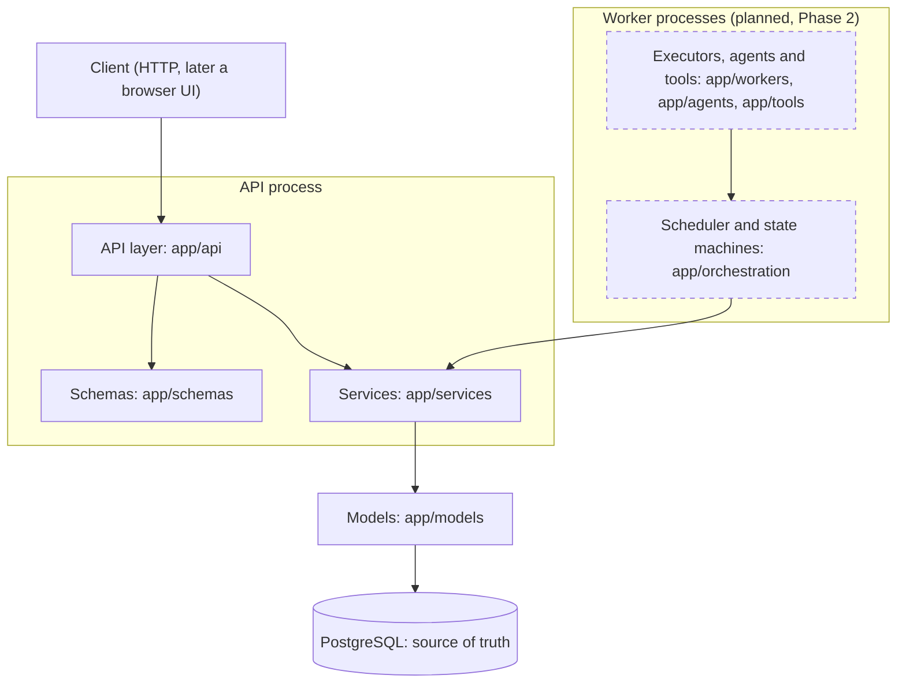
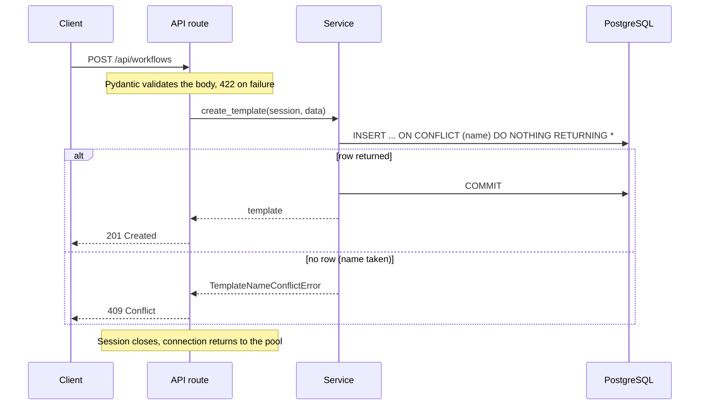
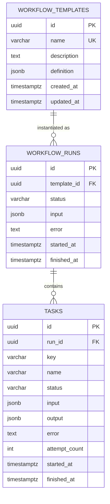

# Architecture overview

How AgentFleet is structured and how a request moves through it. This page describes what exists
today and marks what is planned. It is updated at the end of every phase.

- Decisions and their alternatives: [`../decisions/`](../decisions/)
- Subsystem designs: [`../design-docs/`](../design-docs/)
- Plan and progress: [`../roadmap.md`](../roadmap.md)

## System shape

AgentFleet is a modular monolith: one codebase, deployed as an API process and, from Phase 2,
separately run worker processes. Both share the same service and model code, and PostgreSQL is the
only place workflow state lives.

## Layers and their rules

| Layer | Package | Responsibility | Must not |
|---|---|---|---|
| API | `app/api` | Validate input, call a service, map domain errors to HTTP status codes | Contain business rules or SQL |
| Schemas | `app/schemas` | Shapes and validation of requests and responses (Pydantic) | Touch the database |
| Services | `app/services` | Business rules and transaction boundaries | Import FastAPI |
| Models | `app/models` | Tables, columns and constraints (SQLAlchemy) | Contain behaviour |
| Core | `app/core` | Settings, engine and session factories | Depend on other app packages |
| Orchestration | `app/orchestration` | Dependency graphs (built); state machines and scheduling (planned) | Know about HTTP |
| Workers | `app/workers` | Claim and execute tasks (planned) | Bypass services to change state |

Dependencies point downward only. Services have no web framework imports so that workers can call the
same functions the API calls.

## Life of a request

Creating a workflow template, the one write path that exists today:

Two rules are visible here and apply to every write path:

1. **Commit before responding.** The service commits before it returns, so a success response is never
   sent for a write that could still fail ([ADR-0004](../decisions/0004-session-and-transaction-boundaries.md)).
2. **The database arbitrates races.** Uniqueness is decided by a constraint inside one statement, not by a
   read followed by a write.

## Data model

- A template's task graph is one validated JSONB document, because a template is read and written whole.
- A run's tasks are rows, because workers will lock and update them one at a time.
- Deleting a run deletes its tasks. Deleting a template that has runs is refused, so history cannot be
  removed by accident.
- Status columns are text with CHECK constraints listing the allowed values.

Rationale: [ADR-0003](../decisions/0003-initial-data-model.md).

## Guarantees and where they are enforced

Each guarantee is enforced at the lowest layer that can enforce it and is proven by a test.

| Guarantee | Mechanism | Test |
|---|---|---|
| Template names are unique, even under concurrent requests | Unique constraint with `ON CONFLICT DO NOTHING` | `test_concurrent_duplicate_creates_have_one_winner` |
| A success response means the data is committed | Services commit before returning | `test_create_then_read_template` (reads through a second session) |
| A unit of work is all or nothing | One transaction per unit of work | `test_failed_commit_persists_nothing` |
| Only known statuses can be stored | CHECK constraints | `test_database_rejects_unknown_status` |
| A template's dependencies can always be satisfied (no cycles) | Kahn's algorithm in template validation ([ADR-0008](../decisions/0008-dependency-graph-validation.md)) | `test_cyclic_template_is_rejected_and_names_the_cycle`, `tests/unit/test_dag.py` |
| A run cannot contain the same task twice | Unique constraint on `(run_id, key)` | `test_task_keys_are_unique_within_a_run` |
| Execution history cannot be orphaned or silently deleted | Foreign keys with RESTRICT and CASCADE | `test_template_with_runs_cannot_be_deleted`, `test_deleting_a_run_deletes_its_tasks` |
| The schema matches the models | `alembic check` in tests and CI | `test_models_match_migrations` |
| Migrations can be reversed | Downgrade and upgrade round trip | `test_downgrade_then_upgrade_round_trip` |
| Errors do not leak connection details | Generic readiness failure message | `test_readiness_reports_unreachable_database` |

## Process and deployment view

| Process | Status | Notes |
|---|---|---|
| API (`uvicorn app.main:app`) | Built | One connection pool per process, created at startup and disposed at shutdown |
| PostgreSQL 17 | Built | Docker Compose locally, a service container in CI |
| Worker (`python -m app.workers`) | Planned, Phase 2 | Claims tasks with `FOR UPDATE SKIP LOCKED`; several can run at once |
| Frontend | Planned, Phase 6 | React and TypeScript, consuming the API and the event stream |

## Planned execution model

The parts below are not built. They are summarized here so the direction is visible; each gets a design
doc before implementation.

1. **Run creation (Phase 1, [design doc 0001](../design-docs/0001-run-lifecycle.md)).** A template is
   materialized into a run, its tasks and their dependency rows in one transaction. Run and task states change only through a transition function that uses
   compare-and-set, so an invalid or concurrent transition changes nothing.
2. **Scheduling and claiming (Phase 2).** A task becomes `queued` when all of its dependencies are
   completed. Workers claim queued tasks with row locks that skip rows another worker holds.
   Each transition writes an event in the same transaction.
3. **Durability (Phase 3).** A claim is a lease with an expiry that the worker extends while it works.
   If the worker dies, the lease expires and another worker takes the task. Delivery is at least once,
   so handlers are given idempotency keys; exactly-once execution is not claimed.
4. **Agents and tools (Phase 4).** An agent is a task handler that calls a model through a provider
   interface and may call only allowlisted tools with validated arguments, timeouts and output limits.

## Design principles

1. The API layer is separate from execution logic.
2. Workflows are persistent state machines; invalid transitions are rejected.
3. PostgreSQL is the source of truth for workflow state.
4. Task dependencies are explicit and acyclic.
5. State transitions are persisted before they are reported.
6. Delivery is at least once with idempotent operations.
7. Events are a persisted record of execution.
8. Business logic is separate from infrastructure.
9. A modular monolith with independently run workers; no microservices.
10. The scheduler and executor are written in this project, not delegated to an orchestration framework.
