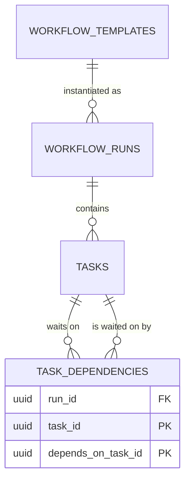
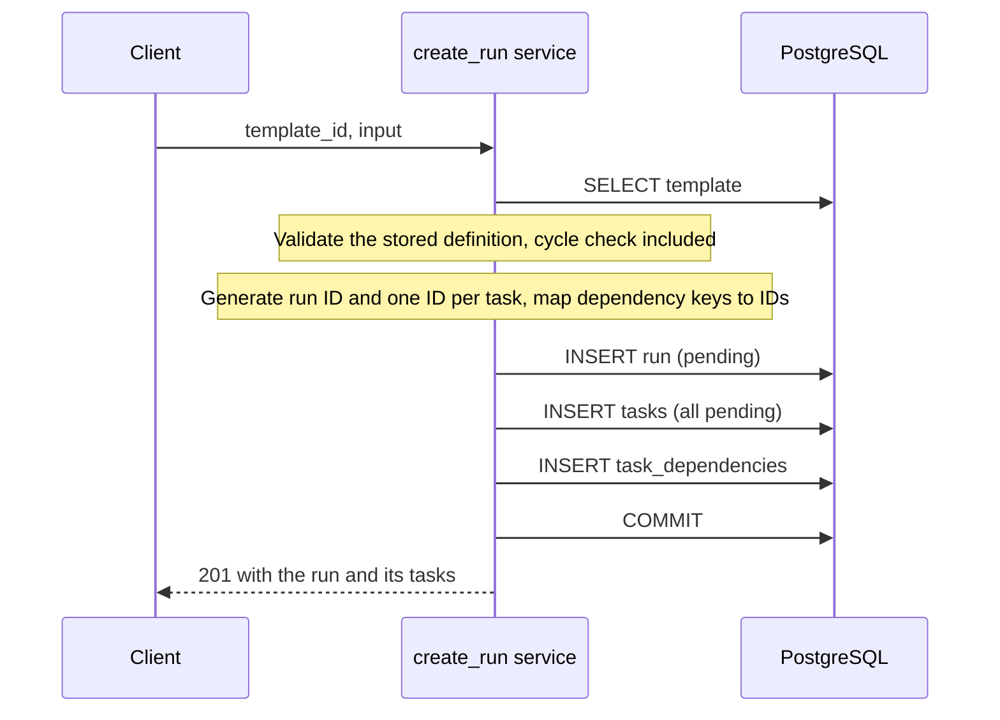
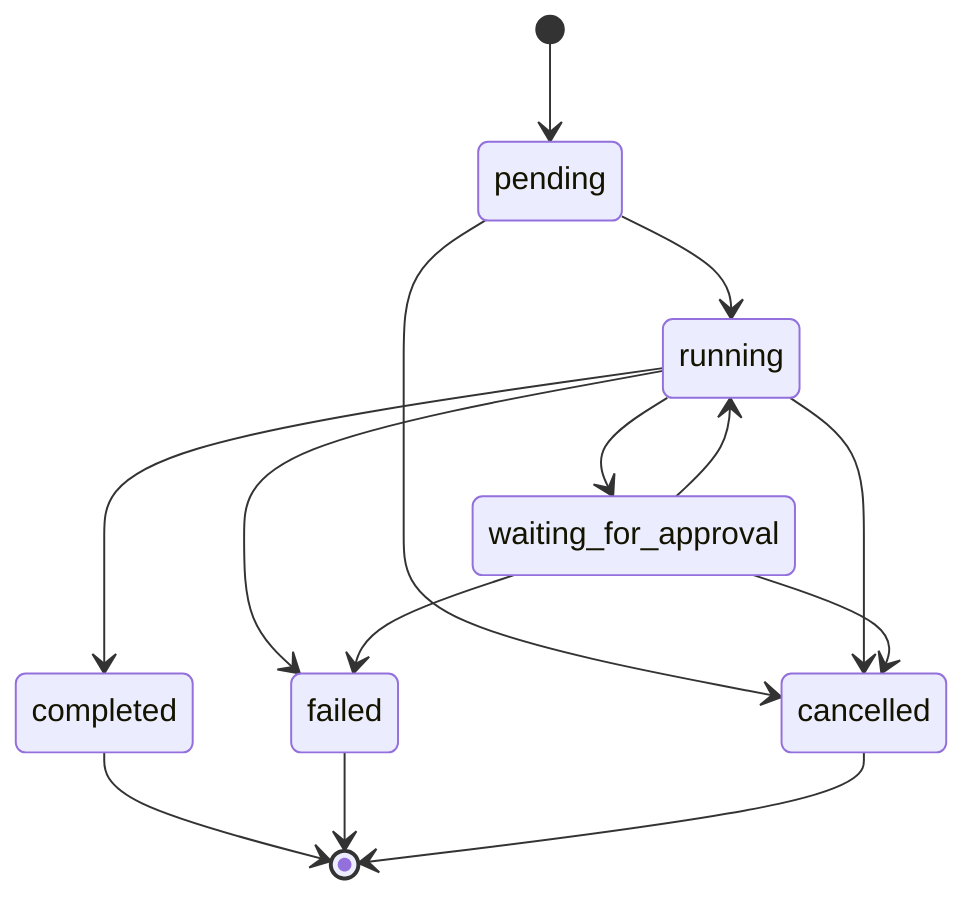
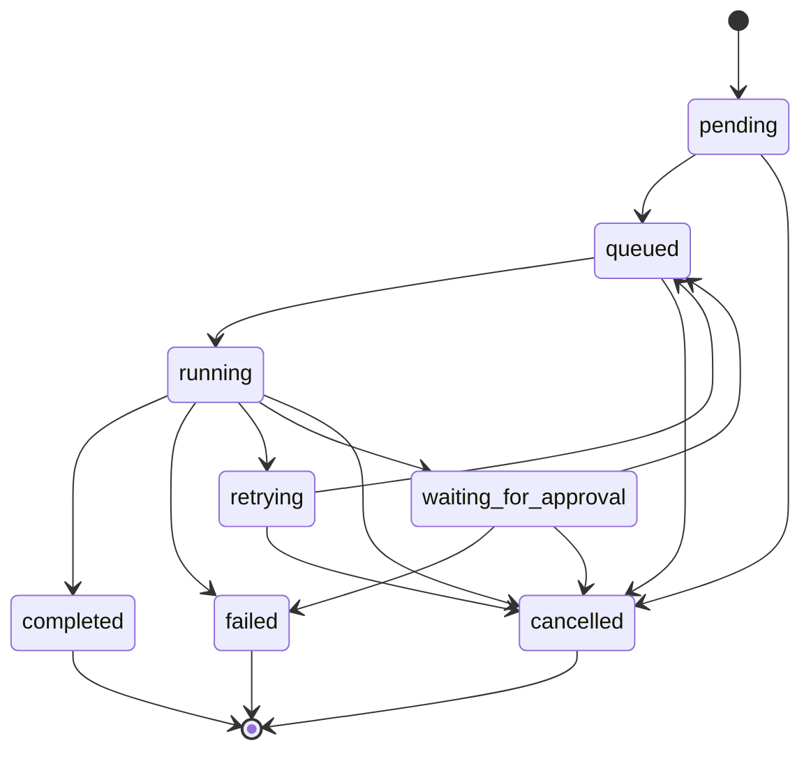

# Design 0001: Run lifecycle

Status: accepted
Phase: 1    Related ADRs: [0003](../decisions/0003-initial-data-model.md),
[0004](../decisions/0004-session-and-transaction-boundaries.md),
[0008](../decisions/0008-dependency-graph-validation.md)

Covers dependency graph validation, run creation and the run and task state machines.
Execution (scheduling, claiming, workers) is designed in 0002.

## Problem
A workflow template describes tasks and the order they must run in. To execute one, the system needs:

1. A guarantee that the described order is possible at all. A template in which `a` waits for `b` and `b`
   waits for `a` can never finish, and nothing downstream should have to discover that at run time.
2. A concrete, persistent instance of the template (a run) whose tasks can be locked, updated and
   inspected one at a time.
3. Rules about which state changes are legal. If a task can go from `pending` to `completed` without
   running, or two processes can both move the same task, then every later feature (scheduling, retries,
   recovery) is built on state that cannot be trusted.

## Goals and non-goals

**Goals**
- No cyclic template can be stored, and the error names the cycle.
- A run, its tasks and their dependencies are created atomically: all of them or none.
- A run is unaffected by later changes to its template.
- Run and task states change only along declared transitions, and a transition requested from a stale
  state changes nothing.
- A dependency can only connect two tasks of the same run.

**Non-goals**
- Executing tasks, deciding readiness, or deriving run status from task status (design 0002).
- Leases, retries and attempt history (design 0003).
- Deduplicating repeated run submissions. Until Phase 3 adds idempotency keys, a client that retries a
  lost response creates a second run.
- Editing a template or a run's graph after creation. Both are immutable.

## Design

### Terms
| Term | Meaning |
|---|---|
| Template | A reusable definition: named tasks and their dependencies, stored as one JSONB document |
| Run | One execution of a template |
| Task | One step of a run, stored as its own row |
| Dependency | An edge "task B depends on task A": A must complete before B may start |

### 1. Dependency graph validation
A template's tasks and `depends_on` lists form a directed graph. It must be acyclic (a DAG).

**Algorithm.** Kahn's algorithm, in `app/orchestration/dag.py`:

1. Count each task's unmet dependencies.
2. Put every task with none in a queue, in definition order.
3. Take a task from the queue and append it to the result. Each task that depends on it now has one
   fewer unmet dependency; when a task reaches zero it joins the queue.
4. Repeat until the queue is empty.

If every task was emitted, the result is a topological order: each task appears after everything it
depends on. If some were not, each of them is waiting on another task that was also never emitted, which
is only possible when a cycle exists.

**Naming the cycle.** The leftover tasks are those on a cycle plus those downstream of one. To report an
actual cycle, start at any leftover task and repeatedly step to one of its dependencies that is also
leftover. Such a dependency always exists, so the walk must eventually revisit a task; the path between
the two visits is a cycle. The error carries it as a list, for example `["a", "b", "a"]`.

**Properties.** Runs in time proportional to tasks plus dependencies. Iterative, so graph depth cannot
exhaust the call stack. Deterministic: the same definition always yields the same order and the same
reported cycle. Pure: no database, HTTP or Pydantic imports, so it is unit-tested in isolation and
reused by the scheduler.

**Where it runs.**
- When a template is created: `WorkflowDefinition` validation calls it, so a cyclic template is rejected
  with `422` and a message such as `dependency cycle: a -> b -> a`.
- When a run is created: the stored definition is validated again (see failure modes).

### 2. Data model changes



**`task_dependencies`** (migration `0002`, with run creation)

| Column | Notes |
|---|---|
| `run_id` | Part of both foreign keys below |
| `task_id` | The task that waits |
| `depends_on_task_id` | The task it waits for |

- Primary key `(task_id, depends_on_task_id)`: an edge exists at most once, and "what does this task wait
  for" is an index lookup.
- Index on `depends_on_task_id`: "which tasks wait for this one" is the lookup the scheduler performs each
  time a task completes.
- Foreign keys `(run_id, task_id)` and `(run_id, depends_on_task_id)`, both referencing
  `tasks (run_id, id)` with `ON DELETE CASCADE`. Because both ends share one `run_id` column, an edge
  between tasks of different runs cannot be stored. This requires a unique constraint on
  `tasks (run_id, id)` as the reference target.
- `CHECK (task_id <> depends_on_task_id)`.

The database cannot express "this set of edges has no cycle". That is guaranteed by validating before
insert and by never updating edges afterwards.

**`tasks.status`** gains `cancelled` (migration `0003`, with the state machines). It is the terminal state
of a task that will never run: its run was cancelled, or a task it depends on failed permanently.
Without it, such tasks would stay `pending` forever and a finished run would look unfinished.

### 3. Run creation

`POST /api/workflows/{template_id}/runs` with a JSON body `{"input": {...}}`.



- **One transaction.** The three inserts commit together (ADR-0004). A failure at any point leaves no rows.
- **IDs are generated in the application** (ADR-0003), so dependency rows can be built from the
  key-to-ID map without reading the inserted tasks back.
- **The run is a snapshot.** Each task row copies its key and name from the definition. The run keeps
  `template_id` for provenance but never reads the template again.
- **Everything starts `pending`.** Run creation does not queue anything. Deciding which tasks are ready is
  the scheduler's responsibility (design 0002), so that rule lives in exactly one place.
- **Input is bounded.** `input` must be a JSON object within a size limit, like every other request body.

Read paths: `GET /api/runs/{id}` returns the run with its tasks and each task's dependency keys;
`GET /api/runs` lists runs.

### 4. State machines

**Runs**



**Tasks**



| Task state | Meaning | First used |
|---|---|---|
| `pending` | Created; at least one dependency is not completed, or the scheduler has not looked yet | Phase 1 |
| `queued` | Ready to run; waiting for a worker | Phase 2 |
| `running` | Claimed by a worker | Phase 2 |
| `completed` | Finished successfully (terminal) | Phase 2 |
| `failed` | Finished unsuccessfully and will not be retried (terminal) | Phase 2 |
| `retrying` | An attempt failed; waiting for its backoff delay before being queued again | Phase 3 |
| `cancelled` | Will never run or was stopped (terminal) | Phase 3 |
| `waiting_for_approval` | Paused until a person approves or rejects | Phase 5 |

The whole table is implemented and tested in Phase 1. Later phases start using more of its edges; they do
not add edges without amending this document.

**Transition function.** All status changes go through one function per entity:

```python
async def transition_task(
    session: AsyncSession, task_id: UUID, *, expected: TaskStatus, to: TaskStatus
) -> Task: ...
```

1. If `to` is not an allowed successor of `expected`, raise `InvalidTransitionError`. No SQL is executed.
   This is a programming error in the caller.
2. Execute a compare-and-set update:
   `UPDATE tasks SET status = :to, ... WHERE id = :id AND status = :expected RETURNING *`.
3. If no row comes back, raise `StaleStateError`: the task is not in the state the caller believed,
   because another process moved it first or it does not exist.

The caller always states the state it believes the task is in, and the database applies the change only
if that belief is still true. There is no read followed by a write, so there is no window in which two
processes can both decide to act.

The function does not commit. The calling unit of work commits, so that a transition and anything that
must accompany it (from Phase 2, its event) become durable together.

Timestamps are maintained by the same statement: `started_at` is set the first time a task or run enters
`running`, `finished_at` when it enters a terminal state.

The allowed transitions are declared as data (`dict[Status, frozenset[Status]]`) in one module, so the
table in this document, the code and the exhaustive test are the same list.

## Failure modes

| Situation | What happens | Guarantee |
|---|---|---|
| The process dies during run creation | The transaction never commits | No partial run exists |
| The database rejects one insert | The transaction rolls back | No partial run exists |
| A client retries run creation after losing the response | A second run is created | None until Phase 3 (`Idempotency-Key`); documented limitation |
| Two processes request the same transition at once | One update matches the row; the other matches nothing and raises `StaleStateError` | Exactly one transition is applied |
| A caller requests a transition that is not in the table | `InvalidTransitionError` before any SQL | Illegal transitions cannot be requested through the service |
| The stored definition of a template is cyclic or otherwise invalid (stored before validation existed, or changed by hand) | Run creation re-validates and refuses with `409` | A run is never created from an invalid graph |
| A template is deleted while a run is being created from it | Whichever commits first wins: the delete is blocked by `ON DELETE RESTRICT`, or the run insert fails its foreign key and the request returns `404` | No run references a missing template |
| An edge is written between tasks of different runs | Rejected by the composite foreign keys | Dependencies stay within a run |
| A status is changed with raw SQL, skipping the transition function | The CHECK constraint still rejects unknown values, but an illegal transition between valid values is not detected | Not guaranteed; all writers must use the transition function (see alternatives) |

## Alternatives considered

- **Depth-first search with three colours for cycle detection.** Finds a cycle directly. Kahn's algorithm
  was chosen because it also yields the topological order, is naturally iterative, and its core idea
  ("a task is ready when it has no unmet dependencies") is the same rule the scheduler applies at run time.
- **Validating the graph only when a run is created.** Simpler, but an invalid template would be accepted
  and fail later, far from the request that caused it.
- **Storing a task's dependencies as an array column.** One table fewer, but no foreign keys, no
  protection against edges to missing or foreign tasks, and no index for "which tasks wait on this one".
- **A single-column foreign key from each end of an edge to `tasks.id`.** Simpler than the composite keys,
  but allows an edge between tasks of different runs.
- **Enforcing transitions with a database trigger.** Would also catch raw SQL. Rejected for now: the rules
  would live in SQL and Python, be harder to unit-test and to change in a migration, and every writer
  already goes through the service layer. Worth revisiting if a second writer appears.
- **Optimistic locking with a version column.** More general than comparing the status, and likely to be
  added with leases in Phase 3. For a transition, the status is the only contested value, so comparing it
  is sufficient and needs no extra column.
- **`SELECT ... FOR UPDATE`, check, then `UPDATE`.** Correct, but two round trips and a held lock for what
  one conditional update achieves. Row locks are reserved for claiming, where a worker must choose a row.
- **Queueing dependency-free tasks at run creation.** Saves one scheduler pass, but puts the readiness rule
  in two places.

## Test plan

| Slice | Tests |
|---|---|
| Dependency graph validation | Unit: empty, single, chain, diamond, disconnected, deterministic order; two-node, long and self cycles; a cycle with tasks downstream of it reports only the cycle; unknown dependency; randomized graphs checked against the definition of a topological order. API: cyclic template returns `422` naming the cycle |
| Run creation | Materialized tasks and edges match the definition; a forced failure after the task insert leaves no rows; unknown template `404`; invalid stored definition `409`; cross-run edge rejected by the database |
| State machines | Every (from, to) pair: allowed pairs succeed, all others raise before SQL; stale expected state raises and changes nothing; two connections racing one transition produce one winner; timestamps set once |

## Rollout
1. Dependency graph validation (this slice): code only, no migration.
2. Run creation: migration `0002` adds `task_dependencies` and the unique constraint on `tasks (run_id, id)`.
3. State machines: migration `0003` replaces the task status CHECK constraint to add `cancelled`.

No backfill is needed: no environment holds production data.

## Open questions
1. Status code when a stored template is invalid at run creation: `409` is proposed, since the request is
   well-formed and conflicts with the state of the resource.
2. The size limit for run `input` (64 KiB is proposed), settled in the run creation slice.
