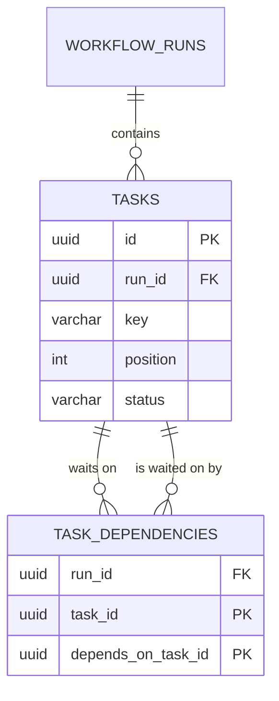
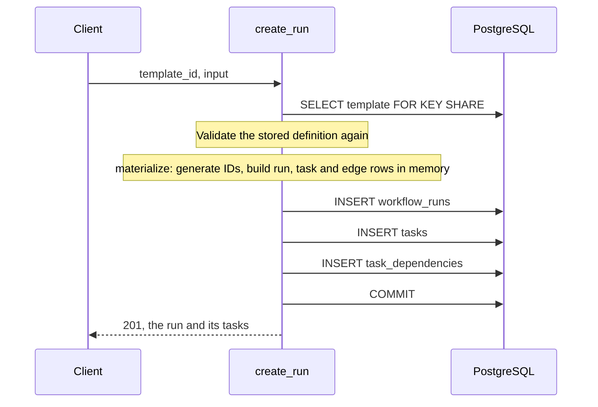

# Slice 05: Run creation

## Goal
Turn a stored workflow template into a run: a concrete, persistent instance whose tasks and dependencies
are database rows that can later be locked, updated and queried one at a time. A run must be created
completely or not at all.

## What was built
- **Migration `0002`:** the `task_dependencies` table, a `position` column on `tasks`, and the unique
  constraints that support them.
- **`app/services/workflow_runs.py`:** `create_run`, `get_run`, `list_runs`, and the pure function
  `materialize` that turns a definition into rows.
- **`app/schemas/run.py`:** request and response shapes, including the bound on run input.
- **`app/api/runs.py`:** three endpoints.
- **`app/api/errors.py`:** validation errors no longer repeat the rejected value (see "Two defects found").

| Endpoint | Success | Errors |
|---|---|---|
| `POST /api/workflows/{template_id}/runs` | `201` with the run, its tasks and a `Location` header | `404` unknown template; `409` stored definition invalid; `422` invalid input |
| `GET /api/runs/{run_id}` | `200` with the run, its tasks and each task's `depends_on` keys | `404` unknown run |
| `GET /api/runs` | `200`, newest first, without tasks (`limit`, `offset`) | `422` paging out of range |

## How it works

**The data model.** A template keeps its graph as one JSON document. A run stores the same graph as rows:



For a four-task template, one run produces these rows:

```text
tasks                              task_dependencies
position  key      status          task     waits for
0         gather   pending         logs     gather
1         logs     pending         deploys  gather
2         deploys  pending         report   logs
3         report   pending         report   deploys
```

**Keeping an edge inside one run.** Each edge row has one `run_id` column, and that column is part of both
foreign keys: `(run_id, task_id)` and `(run_id, depends_on_task_id)` each reference `tasks (run_id, id)`.
PostgreSQL therefore looks up both ends *in the same run*. An edge whose ends belong to different runs has
no matching pair for one of them and is rejected. A foreign key must reference columns declared unique
together, which is why `tasks` gains a unique constraint on `(run_id, id)`.

**Creating a run.**



1. The template is read with a `FOR KEY SHARE` row lock. Until the transaction ends, the template can be
   read and used by other requests but cannot be deleted.
2. The stored definition goes through the same validation as when it was saved. An invalid one raises
   `InvalidTemplateDefinitionError`, which the route maps to `409`.
3. `materialize` generates a UUID for the run and for every task, then builds the edge rows by looking up
   each dependency key in the key-to-ID map. It touches no database, so the mapping is unit-tested alone.
4. The rows are sent in three steps, parents first. `flush()` sends an `INSERT` inside the open
   transaction; nothing is visible to other connections, or permanent, until `commit()`.
5. The service commits and only then returns.

**Reading a run** takes three queries: the run by primary key, its tasks ordered by `position`, and the
edges of those tasks. One helper converts edges into `depends_on` lists of task keys and is used after both
creating and reading, so both return the same representation.

**Run input.** `input` must be a JSON object of at most 64 KiB. NaN, Infinity and the NUL character are
rejected: the JSON parser accepts them, PostgreSQL's `jsonb` does not, and without the check the insert
would fail inside the database and return `500`.

## Why this approach
- Decisions and alternatives: [ADR-0009](../decisions/0009-run-materialization.md). Overall design:
  [design doc 0001](../design-docs/0001-run-lifecycle.md).
- **Two changes to the design doc**, both recorded in ADR-0009 and reflected in the doc:
  `tasks.position` was added because rows inserted in one transaction share a timestamp and so had no
  stable order; and the template is locked `FOR KEY SHARE` instead of translating a foreign key failure
  into `404`, which removes the race instead of handling it afterwards.
- **A pure function for the mapping, a thin function for the writes.** The part with logic has no I/O; the
  part with I/O has almost no logic.
- **The migration handles existing rows.** A required column cannot be added to a populated table in one
  step, so `0002` adds `position` as nullable, numbers existing tasks, then makes it required.
- **The lock mode is the weakest one that works.** `FOR KEY SHARE` conflicts only with deleting the row or
  changing its key, so concurrent run creations of one template do not wait for each other.

## Two defects found
Both were found by probing how unusual JSON values travel through the stack, and each is fixed in its own
commit.

1. **Validation errors repeated the rejected value.** FastAPI's default `422` body includes each rejected
   value under `input`. A request body containing `NaN` was correctly rejected, but the error response then
   could not be written as JSON and the client received `500`. The same echo would return an oversized run
   input to the sender in full. Validation errors now carry the location, message and type only.
2. **A NUL character in template text caused a `500`.** JSON allows `\u0000` in a string; PostgreSQL cannot
   store it in a `text` column. Template names, descriptions and task names now reject it with `422`.

## Technologies introduced
None. Two features of existing tools are used for the first time: PostgreSQL row lock modes
(`FOR KEY SHARE`) and SQLAlchemy engine events, which the tests use to observe and interrupt SQL.

## Tests
206 tests in total (54 added), 100% branch coverage of `app/`.

**Failure injection: `tests/integration/test_workflow_runs.py`.** `tests/sql_hooks.py` registers a hook
that SQLAlchemy calls before every statement. It records the statement and can raise instead of sending a
chosen one. This simulates a failure at an exact point while the earlier statements have really reached
the database.

| Test | Failure it catches |
|---|---|
| Failure while inserting tasks, and while inserting dependencies, leaves no rows | A commit part-way through creation, which would leave a run with missing tasks or edges |
| Creation succeeds after a failed attempt | A failed attempt leaving state behind that blocks the next one |
| The stored graph matches the definition | Wrong key-to-ID mapping, reversed edges, lost tasks |
| `get_run` returns what `create_run` returned | The two paths drifting apart, for example in dependency order |
| Two runs of one template share no rows | Reusing task IDs between runs |
| Unknown template, and invalid stored definition, create nothing | A run created from a missing template or an unrunnable graph |
| The template is read `FOR KEY SHARE` | The lock being dropped in a later change |
| A locked read holds off a concurrent delete; a plain read does not | A lock that does not do what the design claims. The plain-read case is the control that shows the test can tell the difference |

The first, fourth and seventh rows were checked by temporarily introducing the bug each describes and
confirming that the test fails.

**Database constraints: `tests/integration/test_models.py`.** Written with deliberately invalid rows, so
they prove the database refuses them regardless of application code: an edge between tasks of different
runs, an edge whose `run_id` does not match its tasks, a task depending on itself, a duplicate edge, a
duplicate position, and cascade from run to tasks to edges.

**Migration: `tests/integration/test_migrations.py`.** Downgrades to `0001`, inserts tasks in the old
schema, upgrades, and checks that every task received a position. Catches a migration that only works on
an empty database.

**API: `tests/integration/test_workflow_runs_api.py`.** Create and read back through the `Location`
header; `404`, `409` and each kind of invalid input; paging; and eight concurrent creations of one
template, which must all succeed with a complete graph each.

**Unit.** `test_run_materialization.py` covers the mapping without a database. `test_run_schema.py` covers
the input rules, including the exact size boundary and that size is measured in bytes.

## Follow-ups
- Run creation is not idempotent until Phase 3 adds idempotency keys.
- Tasks are created with an empty `input`. How a run's input and upstream outputs reach a task is decided
  with task handlers in Phase 2.
- `GET /api/runs` uses offset pagination and has no filters; keyset pagination replaces it in the last
  slice of Phase 1.
- The `422` body is still FastAPI's shape minus `input`. The uniform error format (RFC 9457) in the last
  slice of Phase 1 replaces it.
- The size limit is applied after parsing. A limit on raw request size is set at the reverse proxy in
  Phase 7.
- Next slice: state machines (migration `0003`, transition tables, compare-and-set transitions).
